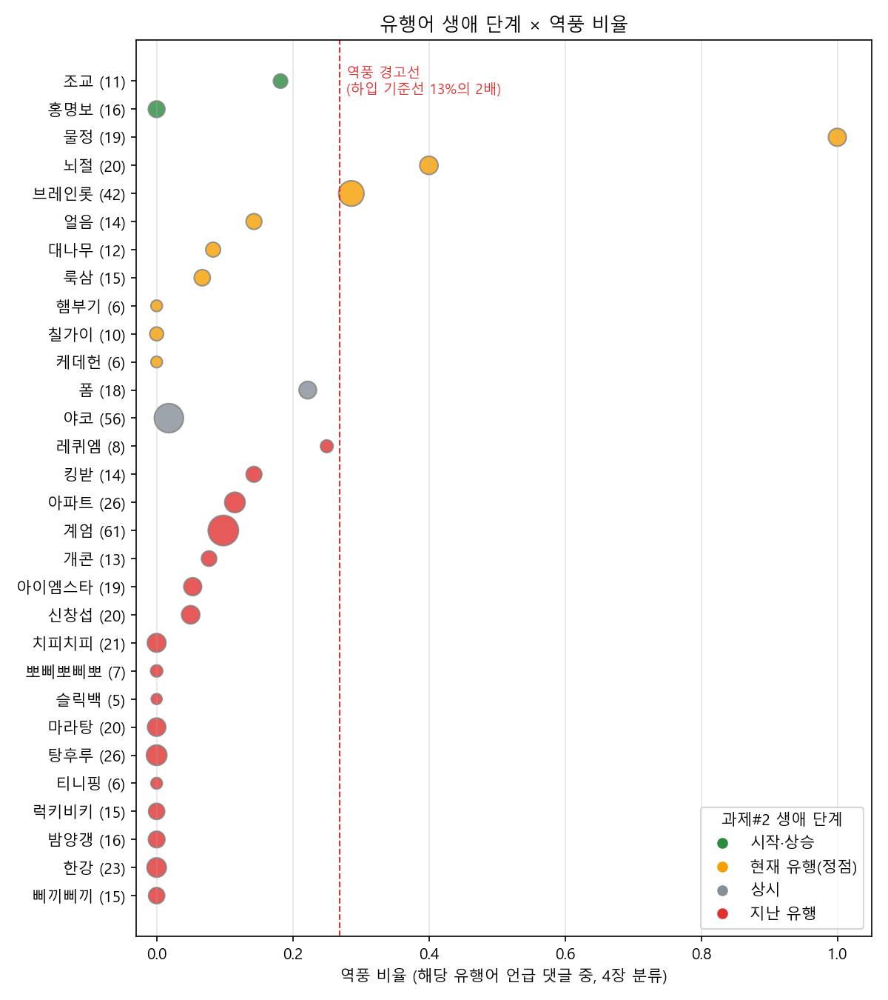

# 밈타 v2 — "이 밈 지금 써도 돼?"

마케터가 밈 이름과 용도를 물으면 🟢 추천 · 🟡 조건부 · 🔴 비추천 · ⚪ 판단 보류로 판정하고, 근거 번호를 단 설명을 돌려주는 에이전트입니다.

LLM 수업(순천향대 AI빅데이터학과, 2026-2학기) 프로젝트이고, 과제#2 「유튜브 댓글로 본 유행어의 생애: BERTopic + LLM 토픽 모델링」을 **확장**했습니다. 과제#2가 답한 "언제 뜨고 지는가"에 "어떻게 받아들여지나"(역풍 비율)와 "무엇이 위험한가"(맥락 RAG)를 더했습니다.

## 파이프라인

판정은 규칙이 하고, LLM은 근거를 인용해 설명만 합니다.

| 수업 | 하는 일 | 모델·기법 |
|---|---|---|
| 5장 (과제#2 재사용) | 유행어 30개 생애 단계 | BERTopic, ko-SRoBERTa 임베딩 |
| 4장 | 댓글 역풍·호감·중립 분류 → 밈별 역풍 비율 | NSMC 감성 모델 / 임베딩 제로샷 / 임베딩+로지스틱 회귀 / EXAONE 퓨샷 |
| 8장 | 맥락 카드 48장 검색 | BM25 + ko-SRoBERTa(FAISS) → RRF |
| 7장 | 도구 3개를 부르는 ReAct 에이전트 | LangChain + EXAONE-3.5-7.8B (4bit NF4) |
| 6장 | 판단 근거 생성 프롬프트 3종 비교 | 기본 / 구조화 / 구조화+예시 1개 |

## 결과 요약 (CPU 구간)

| 항목 | 결과 |
|---|---|
| 역풍 분류 (정답 400건, 5-fold) | 임베딩+LR(balanced) 역풍 F1 **0.54**. NSMC 감성 모델 0.35 |
| 맥락 검색 (질문 26개) | 하이브리드 Hit@3 **1.00**, MRR 0.90 |
| 판정 (유행어 30개) | 🔴 19 · 🟡 7 · 🟢 4 |

홍명보 밈은 과제#2 단계로는 🟢 시작·상승이고 댓글 역풍도 0%였습니다. 실존 인물 조롱이라는 맥락 카드가 있어야 🔴로 판정됩니다.

EXAONE이 필요한 4장 (d), 7장, 6장은 GPU 문제로 아직 실행하지 않았습니다. 자세한 내용은 [결과보고서](결과보고서_MEMETA_v2.md)에 있습니다.

## 파일

| 파일 | 내용 |
|---|---|
| `기획서.md` | 과제#2에서 무엇을 이어받고 어떤 빈칸을 채우는지 |
| `결과보고서_MEMETA_v2.md` | 결과와 발견, 한계 |
| `MEMETA_v2.ipynb` | 전체 실행 노트북 |
| `data/gold_backlash.csv` | 역풍 분류 정답셋 400건 |
| `data/meme_cards.md` | 맥락 카드 48장 (밈 30 · 사례 10 · 가이드 8) |
| `outputs/`, `figures/` | 실행 결과 표와 그림 |

## 실행

노트북은 과제#2 산출물(`../MEMETA_BERTopic/`의 원본 댓글 CSV, `embeddings.npy`, `meme_word_lifecycle.csv`, `topic_labels_reviewed.csv`)을 읽습니다. 이 저장소에는 그 파일들이 들어 있지 않습니다.

- 환경: Python 3.13, torch 2.7.1+cu128, transformers 5.x, langchain 1.x + langchain-classic, sentence-transformers, faiss-cpu, rank-bm25, bitsandbytes
- GPU가 없으면 LLM 단계를 건너뛰고 나머지만 실행합니다.

## 주의

- 정답셋 레이블은 AI(Claude)가 한 번 단 것이고 사람 검수 전입니다.
- 맥락 카드의 "확인 필요" 표시는 기원을 확실히 모르는 정보입니다.
- 댓글은 공개 유튜브 댓글이며 작성자 정보는 포함하지 않았습니다.
