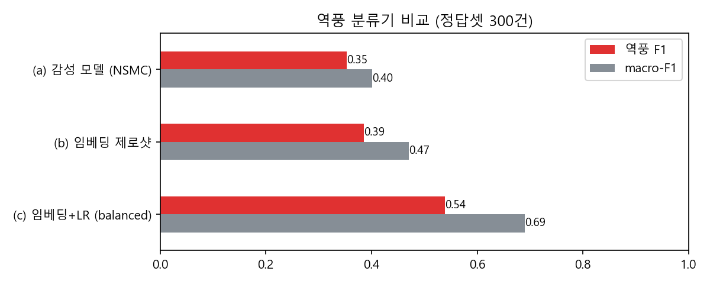
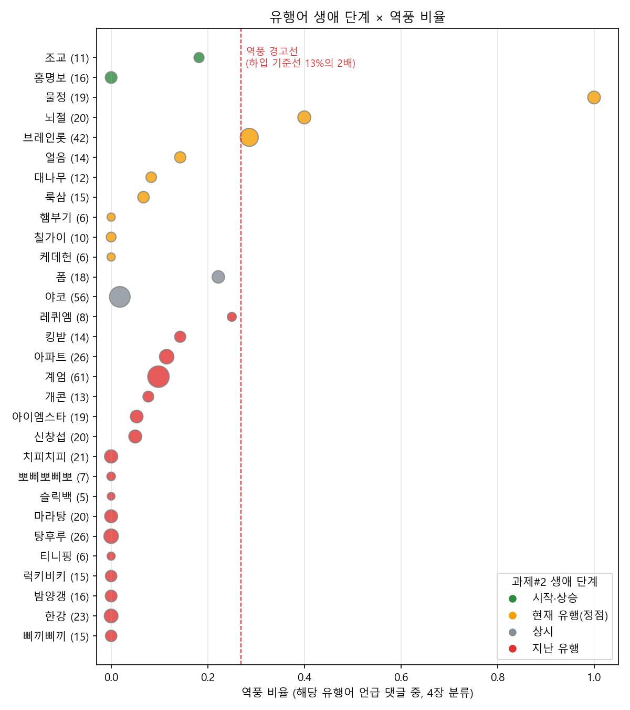

# 밈타 v2 — 결과 보고서 (중간본: CPU 구간)
순천향대학교 AI빅데이터학과 이소미 · LLM 수업 프로젝트 · 2026.11

> "이 밈 지금 써도 돼?"에 근거를 달아 답하는 에이전트. 과제#2 「유튜브 댓글로 본 유행어의 생애」를 **확장**한 프로젝트다.

| 상태 | 장 | 내용 |
|---|---|---|
| ✅ 실행 완료 | 4장 (a)(b)(c) | 역풍 분류기 3종 비교, 밈별 역풍 비율 |
| ✅ 실행 완료 | 5장 × 4장 | 과제#2 생애 단계 × 역풍 비율 결합 |
| ✅ 실행 완료 | 8장 | 맥락 카드 48장, 검색 3방식 비교 |
| ✅ 실행 완료 | 판정 규칙 | 유행어 30개 판정, 자체 점검 assert 통과 |
| ⏸ 미실행 | 4장 (d), 7장, 6장 | EXAONE-3.5-7.8B 필요. 작성 시점에 GPU 드라이버 오류("GPU is lost")로 실행하지 못함 |

미실행 구간은 코드가 노트북에 모두 들어 있고, 가짜 LLM 응답으로 질문 12개 전체 흐름이 오류 없이 끝나는 것까지 확인했다. 재부팅 후 노트북을 다시 실행하면 6·7장 표가 채워진다(7절 참고).

---

## 1. 과제#2에서 무엇을 이어받았나

**과제#2가 남긴 질문:** 생애 단계표로 "지금 뜨는 밈"은 알 수 있었지만, 마케터가 실제로 묻는 "그래서 써도 되나?"에는 답하지 못했다. 과제#2 결과 보고서가 스스로 적은 한계 4가지를 v2가 하나씩 채운다.

| 과제#2의 빈칸 | v2에서 채운 방법 | 결과 |
|---|---|---|
| 언급량만 봤고 반응의 **방향**은 안 봤다 | 4장 역풍 분류 → 밈별 역풍 비율 | 역풍 F1 0.54, 밈 30개 역풍 비율 산출 (2절) |
| 맥락·리스크는 사람이 보고서를 읽어야 알았다 | 8장 맥락 카드 48장 + 하이브리드 검색 | Hit@3 1.00 (4절) |
| 표 여러 개를 사람이 대조해야 했다 | 7장 도구 3개 + 규칙 판정 | 30개 판정 완료, 에이전트는 미실행 (5절) |
| 소형 LLM 출력을 믿을 수 없었다 (오답률 24%) | 판정은 규칙, LLM은 설명만 | 6장 프롬프트 비교는 미실행 (6절) |

**다시 만들지 않고 그대로 쓴 것**
- 원본 댓글 6,420건과 과제#2 전처리 코드: 같은 코드로 4,974건을 재현했다. `assert len(df) == len(emb) == 4974`로 저장된 임베딩과 행 순서가 맞는지 확인한다.
- `embeddings.npy` (ko-SRoBERTa 4,974×768): 4장 분류기의 입력 특징으로 쓴다. 다시 임베딩하지 않는다.
- `meme_word_lifecycle.csv` (유행어 30개 생애 단계): 판정 규칙과 `meme_lifecycle` 도구가 그대로 읽는다. 단계 분포는 지난 유행 17 · 현재 유행 9 · 시작·상승 2 · 상시 2개다.
- `topic_labels_reviewed.csv` (토픽 38개)와 결과 보고서 인사이트 ①~⑤: 맥락 카드의 근거와 가이드 카드 G01~G05로 썼다.

---

## 2. 4장 — 역풍 분류

### 2-1. 정답셋

| 세트 | 건수 | 역풍 | 중립 | 호감 | 뽑은 방법 |
|---|---|---|---|---|---|
| 1차 세그먼트 | 300 | 60 | 131 | 109 | 과제#2 세그먼트(하입 80 · 마케팅 110 · 역풍 110)에서 층화 추출 |
| 2차 밈 언급 | 100 | 9 | 79 | 12 | 유행어 30개를 언급한 댓글에서 추출 |
| 합계 | 400 | 69 | 210 | 121 | |

**역풍**은 브랜드·광고·밈 사용을 비난하거나 조롱하는 댓글로 정의했다. 단순 부정 감성(슬픔, 다른 대상 비판)은 역풍이 아니다.

⚠ 레이블은 **Claude(AI 코딩 도우미)가 한 번 단 것**이고 사람이 검수하지 않았다. 레이블 간 일치도도 재지 못했다. 아래 수치는 이 정답셋 기준이다.

### 2-2. 방법 비교 (400건, 5-fold 교차검증)



| 방법 | 역풍 정밀도 | 역풍 재현율 | **역풍 F1** | macro-F1 | 정확도 |
|---|---|---|---|---|---|
| (a) 감성 모델 NSMC (`koelectra-small-v3-nsmc`) | 0.252 | 0.594 | 0.353 | 0.401 | 0.402 |
| (b) 임베딩 제로샷 (레이블 설명문과 코사인 유사도) | 0.368 | 0.406 | 0.386 | 0.471 | 0.495 |
| (c) 임베딩 + 로지스틱 회귀, 가중치 없음 | 0.710 | 0.319 | 0.440 | 0.668 | 0.745 |
| **(c) 임베딩 + 로지스틱 회귀, class_weight=balanced** | 0.459 | 0.652 | **0.539** | **0.690** | 0.712 |
| (d) EXAONE 퓨샷 | — | — | — | — | ⏸ 미실행 |

**발견 1 — "부정 감성 ≠ 역풍".** 영화 리뷰로 학습한 감성 모델은 역풍 F1이 0.35에 그쳤다. 틀린 예를 보면 "직원분이 너무 불쌍하다...하나 사드려야겠다"는 감성은 부정이지만 브랜드에 호의적이다. "광고주까지 조져버리는 핫소스 클라스"는 단어는 거칠지만 칭찬이다. 역풍은 감성이 아니라 **누구를 향한 반응인지**로 정해진다.

**발견 2 — 역풍은 소수 클래스라 가중치가 필요했다.** 가중치가 없으면 정밀도는 0.71로 높지만 역풍의 3분의 1만 잡는다. 마케터에게는 역풍을 놓치는 쪽이 더 비싸므로 재현율이 0.65인 balanced 모델을 골랐다.

혼동행렬(balanced)을 보면 정답 역풍 69건 중 45건을 맞혔다. 역풍으로 예측한 98건 중 53건이 오답이었고, 그중 46건은 정답이 중립이었다. 중립을 역풍으로 과하게 잡는 경향이 남아 있다.

### 2-3. 학습 분포 ≠ 적용 분포 (2차 정답셋을 만든 이유)

처음에는 1차 300건만으로 학습했다. 그런데 이 분류기를 전체 댓글에 적용하자 밈을 나열한 댓글을 역풍으로 대거 분류했다. 예를 들어 "햄부기? 그건 왜 없지", "꽁꽁 얼어붙은 한강위로 고양이가 걸어다닙니다 ㅋㅋ" 같은 댓글이다. 1차 세트의 역풍이 대부분 '역풍 영상' 세그먼트에서 왔기 때문에, 분류기가 "역풍 영상에 달릴 법한 말투"를 학습한 것이다.

| 2차 밈 언급 100건 (실제 역풍 9건) | 역풍 예측 | 그중 정답 | 정확도 |
|---|---|---|---|
| 1차 300건으로만 학습 | 19건 | 5건 | 0.66 |
| 400건 교차검증 | — | — | **0.87** |

에이전트가 실제로 판단하는 대상은 밈 언급 댓글이다. 그래서 그 분포에서 정답을 따로 뽑아 학습에 넣었다. 이 실험은 노트북 2-4b 셀에 남겨 두었다.

### 2-4. 밈별 역풍 비율

balanced 모델을 4,974건 전체에 적용했다. 정답셋에 있는 댓글은 정답 레이블로 덮어썼다.

| 세그먼트 | 역풍 | 호감 | 중립 |
|---|---|---|---|
| 하입 (밈 소개 영상) | 13.7% | 23.2% | 63.1% |
| 마케팅 (브랜드 밈 광고) | 17.9% | 52.2% | 29.9% |
| 역풍 (논란 영상) | 53.3% | 26.9% | 19.8% |

분류기가 세그먼트 차이를 재현한다. 하입 영상 댓글 전체의 역풍 비율 **13.4%를 기준선(HYPE_BASE)**으로 두고, 그 2배(약 27%)를 경고선으로 썼다.

---

## 3. 5장 × 4장 — 생애 단계와 역풍을 함께 보기



| 유행어 | 과제#2 단계 | 언급 | 역풍 비율 | 해석 |
|---|---|---|---|---|
| 물정 | 🟡 현재 유행 | 19 | **100%** | 브랜드 사과문의 "세상 물정 모르는" 표현이 밈이 됨. 언급 19건이 모두 역풍 영상 댓글 |
| 뇌절 | 🟡 현재 유행 | 20 | 40% | 밈 남용 자체를 비꼬는 말 |
| 브레인롯 | 🟡 현재 유행 | 42 | 28.6% | "요즘 밈은 의미 없다"는 피로 반응이 섞임 |
| 레퀴엠 | 🔴 지난 유행 | 8 | 25% | 표본 작음 |
| 폼 | ⚪ 상시 | 18 | 22.2% | 경고선 아래 |
| 계엄 | 🔴 지난 유행 | 61 | 9.8% | **댓글만 보면 안전해 보임** |
| 홍명보 | 🟢 시작·상승 | 16 | **0%** | **댓글만 보면 안전해 보임** |
| 럭키비키 · 밤양갱 · 한강 | 🔴 지난 유행 | 15~23 | 0% | 반응은 무난하지만 타이밍이 지남 |

**발견 3 — 언급 단계와 반응 방향은 서로 다른 정보다.** 과제#2가 "현재 유행"으로 분류한 9개 중 3개(물정·뇌절·브레인롯)는 역풍 비율이 경고선 근처이거나 그 위다. 과제#2만으로는 이 셋을 "지금 쓰기 좋은 밈"으로 읽었을 것이다.

**발견 4 — 댓글 반응만으로는 위험을 못 잡는 밈이 있다.** 홍명보 언급 16건은 모두 "2026 밈 노래에 홍명보 파트 나올 듯" 같은 하입 영상 댓글이라 역풍이 0%다. 계엄도 61건 중 60건이 하입 영상 댓글이다. 하지만 둘 다 실존 인물 조롱과 정치 사건이라 브랜드가 쓰면 위험하다. 이 위험은 댓글 분포가 아니라 **맥락 지식**에 있다. 8장 RAG를 붙인 직접적인 이유다.

---

## 4. 8장 — 밈 맥락 RAG

### 4-1. 지식베이스: 맥락 카드 48장 (`data/meme_cards.md`)

| 종류 | 장수 | 내용 |
|---|---|---|
| 밈 M01~M30 | 30 | 과제#2 유행어 30개. 기원, 쓰임, 위험도, 근거 토픽 번호 |
| 사례 C01~C10 | 10 | 과제#2 역풍·마케팅 세그먼트에 나온 브랜드 사례 |
| 가이드 G01~G08 | 8 | 과제#2 인사이트 ①~⑤와 운영 원칙 |

- 위험도 '높음'은 7장이다(M28 홍명보, M29 비상계엄, M30 세상 물정, C05~C08). '중간'은 14장이다.
- 기원을 확실히 모르는 밈(대나무 행주, 얼음, 햄부기, 로리신 레퀴엠 등)은 내용을 지어내지 않고 **"확인 필요"**로 표시했다. 이 부분은 사람이 검수해야 한다.

### 4-2. 검색 비교 (질문 26개, 질문마다 정답 카드 1~2장)

질문 절반은 카드 별칭을 그대로 썼고(어휘 일치), 절반은 다른 말로 바꿨다(의미 일치). 예를 들어 "이탈리아 AI 캐릭터 밈"의 정답은 브레인롯 카드다.

| 방식 | Hit@1 | Hit@3 | MRR |
|---|---|---|---|
| BM25 (한국어 글자 2-gram) | **0.846** | 0.923 | 0.892 |
| 밀집 (ko-SRoBERTa + FAISS) | 0.731 | 0.962 | 0.846 |
| **하이브리드 (RRF, k=60)** | 0.808 | **1.000** | **0.897** |

**발견 5 — 1위는 BM25, 3위 안은 하이브리드.** 밈 이름은 고유명사라 글자가 맞으면 BM25가 정확하다. 바꿔 말한 질문에서는 밀집 검색이 보완한다. 에이전트는 상위 3장을 근거로 쓰므로 Hit@3이 1.00인 하이브리드를 골랐다. 하이브리드 top-3에서 정답을 놓친 질문은 없었다(노트북 4-4 셀 출력 없음).

여기에 더해, 판정 대상 밈의 **자기 카드는 검색 결과와 상관없이 항상 근거에 넣는다**. 검색이 틀려도 위험도 정보가 빠지지 않게 하기 위해서다.

---

## 5. 7장 — 도구와 판정 규칙

### 5-1. 도구 3개

| 도구 | 읽는 것 | 출력 예 (럭키비키) |
|---|---|---|
| `meme_lifecycle` | 과제#2 생애 단계표 | 🔴 지난 유행, 언급 15건, lift 최근 0.00 / 과거 2.01, 작성 시점 중앙값 365일 전 |
| `backlash_scan` | 4장 역풍 비율표 | 15건 중 역풍 0건(0%) · 호감 3 · 중립 12 (하입 기준선 13%) |
| `meme_context` | 8장 하이브리드 검색 | 자기 카드 + 관련 카드 top-3 |

질문 속 밈 이름은 카드 별칭(예: "원영적 사고" → 럭키비키)과 데이터 키로 찾는다.

### 5-2. 판정 규칙 — "판정은 규칙, 설명은 LLM"

과제#2에서 소형 LLM 레이블의 오답률이 24%였다. 그래서 신호등 판정은 코드로 정한다.

```
데이터에 없는 밈                                  → ⚪ 판단 보류
카드 위험도 '높음'                                → 🔴 비추천
과제#2 단계 '지난 유행'                            → 🔴 비추천
위험도 '중간' 또는 (역풍 ≥ 기준선×2 이고 언급 ≥ 10) → 🟡 조건부
그 외                                            → 🟢 추천
```

**30개 판정 결과:** 🔴 19 · 🟡 7 · 🟢 4

**자체 점검(assert)이 모두 통과했다:** 계엄 → 🔴, 밤양갱 → 🔴, 폼 미쳤다 → 🟢, 두쫀쿠(데이터 없음) → ⚪.

**테스트 질문 12개와 규칙 판정**

| 질문 | 밈 | 판정 | 결정 근거 |
|---|---|---|---|
| 카페 신메뉴 홍보 릴스에 '럭키비키' 써도 돼? | 럭키비키 | 🔴 | 지난 유행 |
| 편의점 브랜드인데 브레인롯 밈으로 숏폼 만들어도 될까? | 브레인롯 | 🟡 | 역풍 28.6% (경고선 위) |
| 요즘 홍명보 밈 많이 보이던데 스포츠웨어 광고에 써도 돼? | 홍명보 | 🔴 | 위험도 높음 (역풍 0%인데도) |
| 밤양갱 패러디로 디저트 가게 광고하면 어때? | 밤양갱 | 🔴 | 지난 유행 |
| 계엄령 드립으로 블랙프라이데이 할인 이벤트 하면? | 계엄 | 🔴 | 위험도 높음 |
| 러닝화 광고 카피에 '폼 미쳤다' 넣어도 될까? | 폼 | 🟢 | 상시, 역풍 경고선 아래 |
| 꽁꽁 얼어붙은 한강 밈으로 겨울 패딩 홍보 괜찮아? | 한강 | 🔴 | 지난 유행 |
| 칠가이 캐릭터로 굿즈 만들어도 될까? | 칠가이 | 🟡 | 위험도 중간 (저작권) |
| 케데헌 노래 틀고 매장 직원 챌린지 영상 찍어도 돼? | 케데헌 | 🟡 | 위험도 중간 (음원 저작권) |
| 세상 물정 밈으로 화장품 광고 문구 써도 될까? | 물정 | 🔴 | 위험도 높음, 역풍 100% |
| 햄부기 밈으로 수제버거집 릴스 만들고 싶어 | 햄부기 | 🟢 | 현재 유행, 역풍 0% (단, 언급 6건이라 신뢰도 낮음) |
| '두쫀쿠' 밈 지금 써도 돼? | — | ⚪ | 데이터 없음 |

홍명보 질문이 이 프로젝트의 확장 효과를 가장 잘 보여 준다. 과제#2 단계표만 보면 🟢 시작·상승이다. 4장 역풍 비율만 보면 0%다. 8장 맥락 카드가 있어야 🔴가 나온다.

### 5-3. ReAct 에이전트 — ⏸ 미실행

- 구성: `langchain_classic.agents.create_react_agent` + `AgentExecutor` (max_iterations=6, 파싱 오류 허용).
- LLM: EXAONE-3.5-7.8B-Instruct 4bit NF4. LangChain `LLM`을 상속한 `ExaoneLLM`으로 직접 감쌌고, chat template를 적용하고 `stop_strings`로 "Observation:"에서 멈춘다.
- 평가 지표(실행 후 채울 것): 밈 인식률, 에이전트가 스스로 부른 도구 수(3개 중), 질문당 소요 시간.
- 에이전트가 도구를 빠뜨려도 근거 생성 단계(`collect_evidence`)가 빠진 도구를 직접 호출해 채운다. 따라서 최종 답의 판정은 에이전트 성공 여부와 무관하게 규칙 판정과 같다.

---

## 6. 6장 — 판단 근거 생성 프롬프트 비교 — ⏸ 미실행

| 프롬프트 | 구성 | 확인하려는 것 |
|---|---|---|
| A 기본 | 근거만 주고 LLM이 직접 판정 | LLM 판정이 규칙과 얼마나 다른가 (과제#2 인사이트 ⑤ 재검증) |
| B 구조화 | 역할 · 규칙 판정 고정 · 근거 번호 인용 · 출력 형식 | 인용과 형식이 개선되는가 |
| C 구조화 + 예시 1개 | B + 킹받다 예시 답변 | 퓨샷 예시를 복사하는가 (과제#2에서 관찰된 문제) |

**자동 채점(실행 후 채울 것):** 판정 일치, 근거 번호 인용률, 숫자 환각(근거에 없는 % 수치), 형식 준수, 예시 누출("킹받", "고객 응대 문구" 같은 예시 표현이 다른 밈 답에 등장하는지).

---

## 7. 남은 작업

1. PC 재부팅으로 GPU를 복구한 뒤 `MEMETA_v2.ipynb`를 처음부터 실행한다(30~40분 예상). 이때 4장 (d), 7장 에이전트, 6장 프롬프트 비교가 실행된다.
2. 이 보고서의 ⏸ 표시 칸을 `outputs/ch7_agent_eval.csv`, `ch6_prompt_eval_summary.csv`, `agent_runs.jsonl`의 결과로 채운다.
3. 정답셋 400건 중 일부(예: 역풍 69건 전체)를 사람이 다시 확인한다.
4. 맥락 카드의 "확인 필요" 항목을 검수한다.

## 8. 한계

- **데이터 출처:** 데이터는 '릴스'가 아니라 과제#2의 유튜브 댓글이다. 숏폼 밈이 유튜브 밈 총정리 영상으로 다시 모이는 구조라 대리 지표로 썼다.
- **판단 범위:** 판단할 수 있는 밈은 과제#2의 30개뿐이다. 새 밈은 ⚪로 답한다.
- **시점:** 2026년 10월 수집 시점 기준의 판정이다.
- **정답셋:** AI가 단 1인 레이블이다. 역풍은 69건으로 적어서 F1의 분산이 크다.
- **표본 크기:** 밈별 역풍 비율은 언급 5~61건에서 나왔다. 케데헌·햄부기·티니핑(6건) 같은 밈은 비율이 한두 건으로 바뀐다. 판정 규칙에 언급 10건 이상 조건을 둔 이유다.
- **맥락 카드:** 사람이 직접 작성한 지식이라 카드 내용이 판정을 좌우한다. 위험도 '높음' 판단은 작성자의 판단이다.

## 9. 결론 (CPU 구간 기준)

과제#2는 **"언제"**(생애 단계)를 답했다. v2는 여기에 **"어떻게 받아들여지나"**(역풍 비율)와 **"무엇이 위험한가"**(맥락 카드)를 더했다. 그 결과 "써도 되나?"에 근거를 단 판정을 낼 수 있게 됐다.

세 정보는 서로를 대신하지 못한다. 현재 유행인데 역풍이 높은 밈(물정·뇌절·브레인롯), 반응은 좋은데 위험한 밈(홍명보·계엄), 반응도 무난하고 위험도 낮지만 이미 지난 밈(럭키비키·밤양갱)이 각각 존재한다. 하나만 봤다면 셋 중 하나는 놓쳤을 것이다.
